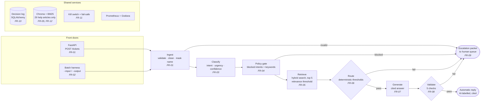

# CloudServe Support Triage

An AI-assisted support system for **CloudServe Solutions**, a cloud infrastructure company whose support team is missing its response-time SLA. The system reads each incoming ticket, answers it automatically when it can do so safely and with cited sources, and otherwise hands it to a human with a complete summary attached.

> **Project status (11 November 2026):** intake (FR-01), the batch harness (FR-02), classification (FR-03), the policy gate (FR-04), hybrid retrieval (FR-05), routing (FR-06) and the kill switch (part of FR-11) are built and tested. All 80 validation tickets run through the real pipeline with zero must-never-automate tickets answered. Generation (FR-07) is next: until then, tickets routed to an automatic answer have no reply text. See [Build status](#build-status).

---

## Contents

1. [The problem](#the-problem)
2. [What the system does](#what-the-system-does)
3. [Architecture](#architecture)
4. [How a ticket flows through the system](#how-a-ticket-flows-through-the-system)
5. [Technology stack](#technology-stack)
6. [Project structure](#project-structure)
7. [Getting started](#getting-started)
8. [Running the system](#running-the-system)
9. [Reason codes](#reason-codes)
10. [Error handling](#error-handling)
11. [Safety, privacy and governance](#safety-privacy-and-governance)
12. [Testing](#testing)
13. [Build status](#build-status)
14. [Requirements traceability](#requirements-traceability)
15. [Known limitations](#known-limitations)
16. [Project documents](#project-documents)

---

## The problem

CloudServe receives 500+ support tickets a week through four channels (email, chat, documentation comments and a community forum), handled by six agents. First replies take 8 to 12 hours against a 2-hour SLA, and customer satisfaction is falling.

The client asked for a chatbot. Analysis of 500 historical tickets and five stakeholder interviews showed the real problem is different:

| Finding | Evidence |
|---|---|
| **The answers already exist.** 71.4% of tickets are answerable from CloudServe's own 29 help articles. | `answerable_from_docs` label |
| **Tier 1 is already fast.** Tickets resolved at first contact close in a median of **32 minutes**. | `resolution_time_minutes` |
| **Escalation is where time is lost.** Escalated tickets take a median of **745 minutes (about 12.5 hours)**, have lower satisfaction (2.63 vs 3.41), and account for **every** repeat contact. | `escalated`, `csat_rating`, `repeat_contact` |
| **Half of escalations were unnecessary.** 49% of escalated tickets had an answer in the documentation. | `escalated` and `answerable_from_docs` |
| **Urgency is ignored.** High-urgency tickets are handled no faster than low-urgency ones. | `urgency` vs resolution time |
| **The highest-paying customers get the slowest service.** Enterprise: 63% escalated, median 369 min. Business: 52%, 141 min. | `customer_tier` |

**Problem statement:** CloudServe isn't short of answers; it's short of a way to reach them. Fixing response time alone won't help. What has to change is how many tickets are settled the first time, and how much context comes with the ones that genuinely need a senior engineer.

---

## What the system does

For every ticket, the system makes exactly one of two decisions, and records why.

**Answer automatically**, only when all of these hold:
- the ticket is not in a category that must always go to a human (security incidents, compliance requests, feature requests, unclear requests);
- the classifier is confident about what the customer is asking;
- a relevant help article was found;
- the drafted answer passes every safety check before it is sent.

Every automatic answer cites the help article behind each claim and is labelled as AI-drafted.

**Escalate to a human**, in every other case, with an escalation packet so the engineer never has to re-read the thread or re-ask the customer:
- a summary of three sentences or fewer;
- the predicted intent, urgency and confidence;
- the help articles found and a draft answer, where possible;
- a specific list of what the system was unsure about;
- the reason code for escalating.

Escalated tickets are queued by **urgency, then customer tier, then age**, not by age alone.

**Design principle:** the system would rather say nothing than say something wrong. Every safety rule is enforced by code, not by asking a language model to behave.

---

## Architecture



### Three layers

| Layer | Contents | Why it is separate |
|---|---|---|
| **Application** | FastAPI endpoint, batch harness, LangGraph orchestration, guardrails, response formatting | Owns the decision flow and every safety rule |
| **Model and retrieval** | Classifier, embedding model, Chroma vector store, answer generator, claim checker | Can be swapped (another model or vector store) through configuration, without touching the application layer |
| **Persistence and observability** | Decision log (SQLAlchemy), Prometheus metrics, Grafana dashboards, GitHub Actions CI | Every decision is reconstructable and every run is measurable |

### Key design decisions

| Decision | Reason |
|---|---|
| **Safety rules are code, not prompts.** The policy gate, routing and kill switch use no language model at all. | A rule such as "never auto-answer a security incident" must not depend on a model following instructions. |
| **Every decision is deterministic.** The same ticket always gets the same route (acceptance criterion A5). | The Build Specification checks that a repeated ticket gets the same decision. Classification, the policy gate, retrieval and routing contain no randomness. |
| **Classification by nearest-neighbour vote, not a language model.** The 15 most similar labelled development tickets vote on intent and urgency; the winning share is turned into a calibrated confidence. | Deterministic, needs no model calls (the free tier allows 50 a day), and the confidence is measured: when it says 0.98 it is right about 97% of the time. Held-out intent accuracy 94.8%. |
| **Honest evaluation: duplicate tickets never cross between training and testing.** | Only 216 of the 500 development ticket texts are unique. A first version scored 99.8% because duplicates leaked into the test folds; grouping by text gave the honest 94.8%. |
| **Hybrid retrieval** (meaning-based plus keyword search). | Keyword search fails on "my deployment keeps dying" vs "container health check failures", the documentation owner's main complaint. Meaning-based search alone misses exact error codes. Measured: hybrid recall@5 98.9% vs 96.9% keyword-only. |
| **Embeddings run on ONNX Runtime, not PyTorch.** | Same `all-MiniLM-L6-v2` model, about 2 GB smaller to install, and not blocked by Windows Application Control, which blocked PyTorch's DLLs on the development machine. |
| **Retrieval degrades instead of failing.** | If the embedding model can't load, search falls back to keyword-only (recall@5 still 96.9%) and logs a warning, rather than stopping (A11). |
| **Answers only from the 29 reviewed articles.** Never from agents' private answer files or past replies. | Tier 2 reports that private snippets contain answers that have been wrong for two years. |
| **Two front doors, one pipeline.** The API and the harness both call the same `handle()` function. | Live and batch tickets can never behave differently. |
| **Thresholds are chosen from data, not judgement.** | `eval/retrieval_check.py` set the retrieval threshold at 0.30 (keeps 95.5% of correct articles). `eval/threshold_sweep.py` set the confidence threshold at 0.80: the lowest value where 99% of automatic answers have the right intent. |
| **Keyword safety net in configuration, not code.** | `config/never_auto.yaml` holds the blocked intents and keyword lists, with a version number recorded in every decision. Changing a rule is a reviewable commit. |
| **The retrieval score is a relevance filter, not an answerability signal.** | Tickets the docs *can't* answer score almost as high as ones they can (median 0.58 vs 0.59), because they use the same vocabulary. Whether a ticket is answerable is decided by the policy gate, classifier confidence and the generator's "not answerable" check. |

---

## How a ticket flows through the system

| Step | What happens | Requirement | Status |
|---|---|---|---|
| **1. Ingest** | Validates the ticket against the schema. Email: removes quoted replies and signatures. Tidies whitespace. Replaces the customer's name with `[CUSTOMER]`, so no name reaches an external model. Joins subject and body into one text. Fingerprints the original ticket for the log. | FR-01 | **Built** |
| **2. Classify** | Compares the ticket with the 500 labelled development tickets (TF-IDF similarity); the 15 nearest vote on intent (one of 22) and urgency. The vote share becomes a calibrated confidence (isotonic regression fitted by cross-validation). Records the top three intents considered. Empty or unmatched text gets a defined fallback (`unclear_request`, confidence 0), never an exception. | FR-03 | **Built** |
| **3. Policy gate** | Pure code, three rules: (1) the four never-automate intents; (2) a keyword safety net in `config/never_auto.yaml`, independent of the classifier; (3) tickets of 20 words or fewer that name no product or error. Also flags data residency and billing disputes for a stricter threshold. Records every check and a plain-language reason. Keywords and the unclear rule alone catch 87 of 87 must-never-automate development tickets and 14 of 14 validation tickets. | FR-04 | **Built** |
| **4. Retrieve** | Searches the 29 help articles, split at their headings into 116 sections (Symptoms, Common causes, Resolution, Notes), so resolution steps are never split. Combines MiniLM embeddings in Chroma with BM25 keyword search by reciprocal rank fusion. Returns up to 5 passages, one per article, each with an ID that resolves to the corpus. Passages below the relevance threshold (0.30) are dropped, and an empty list is a valid result. | FR-05 | **Built** |
| **5. Route** | Fixed order of checks: policy gate → relevant passage found → sensitive threshold (0.90) → general threshold (0.80). The first that fails gives the reason code; otherwise `AUTO_RESPONDED`. Every result carries a plain-language reason a support manager can read, naming the runner-up intent when confidence is low. | FR-06 | **Built** |
| **6. Generate** | Writes an answer using only the retrieved passages, as JSON with each claim tied to an article ID. Returns "not answerable" rather than guessing. The AI-drafted label is added by code. | FR-07 | Specified |
| **7. Validate** | Five checks before sending: no private data; citations only from retrieved articles; no promises of refunds, fixes or dates, and no requests for credentials; no advice for a plan the customer isn't on; tone and length per channel. A separate claim-checker model confirms each claim is supported. Any failure escalates. | FR-08 | Specified |
| **8. Escalate** | Builds the escalation packet and places it in the human queue by urgency, tier and age. | FR-09 | Specified |
| **Always** | Kill switch: `KILL_SWITCH=true` sends every ticket to a human. | FR-11 | **Built** |
| **Always** | Logs every decision; escalates instead of failing if the model is unavailable. | FR-10, FR-11 | Specified |

---

## Technology stack

All free and open source, as the brief requires.

| Purpose | Technology |
|---|---|
| Language and packaging | Python 3.14 (tested on 3.14.8), managed with [uv](https://docs.astral.sh/uv/) |
| Data validation | Pydantic v2 |
| API | FastAPI, served by Uvicorn |
| Orchestration | LangGraph (on LangChain) |
| Classification | Nearest-neighbour vote over TF-IDF similarity, with isotonic calibration (scikit-learn) |
| Language model | OpenRouter free models, for generation and claim checking *(from FR-07)*. Configurable. |
| Embeddings | `all-MiniLM-L6-v2`, run with ONNX Runtime (Chroma's built-in model) |
| Vector store | Chroma |
| Keyword search | BM25 (`rank-bm25`) |
| Policy configuration | YAML (`pyyaml`) |
| Decision log | SQLAlchemy: SQLite by default, PostgreSQL by changing `DATABASE_URL` |
| Monitoring | Prometheus and Grafana |
| Testing and CI | pytest, httpx; GitHub Actions |

---

## Project structure

```
CloudServe-Support/
├── src/cloudserve_support/
│   ├── app/
│   │   ├── main.py            FastAPI app: POST /tickets, GET /health
│   │   └── schemas.py         TicketIn, NormalisedTicket, TicketResult, ReasonCode
│   ├── pipeline/
│   │   ├── ingest.py          validation, email cleaning, name masking
│   │   ├── classify.py        nearest-neighbour intent and urgency, calibrated confidence
│   │   ├── policy.py          policy gate: blocked intents, keyword net, unclear rule
│   │   ├── retrieve.py        hybrid retrieval over the 29 articles
│   │   ├── route.py           routing decision and plain-language reason
│   │   └── graph.py           handle() and process(): error boundary, kill switch, pipeline
│   ├── harness/
│   │   └── __main__.py        batch runner: --input / --output / --resume / --limit
│   ├── errors.py              error classes, each mapped to a reason code
│   └── logging_config.py      shared logging setup
├── tests/
│   ├── test_ingest.py         FR-01
│   ├── test_harness.py        FR-02 and the API
│   ├── test_errors.py         error boundary and API error handling
│   ├── test_classify.py       FR-03
│   ├── test_policy.py         FR-04
│   ├── test_retrieve.py       FR-05
│   └── test_route.py          FR-06, kill switch, end-to-end determinism
├── eval/
│   ├── retrieval_check.py     measures retrieval recall and sets the relevance threshold
│   └── threshold_sweep.py     sets the routing confidence thresholds
├── config/
│   └── never_auto.yaml        policy gate rules (versioned)
├── data/                      development, validation and documentation JSON
├── docs/
│   └── architecture_diagram.excalidraw
├── prompts/                   versioned prompt files (PR-01 to PR-04)
├── .env.example               configuration template (no secrets)
├── .python-version
├── pyproject.toml
├── uv.lock
└── README.md
```

Planned additions as the build continues: `pipeline/generate.py`, `validate.py`, `escalate.py`; a model client with response cache; `store/` (decision log); metrics report and fairness audit in `eval/`; `.github/workflows/ci.yml`.

---

## Getting started

### Prerequisites

- [uv](https://docs.astral.sh/uv/getting-started/installation/) (installs the Python version in `.python-version`, 3.14, automatically if needed)
- Internet access on first run: the embedding model (about 80 MB) downloads once and is cached in `~/.cache/chroma`
- A free OpenRouter API key, once generation (FR-07) is added. Classification needs no key.

### Install

```bash
git clone <repository-url>
cd CloudServe-Support
uv sync
cp .env.example .env      # then put your own key in .env
```

Run every command from the project folder. Running pytest from a parent folder makes it search the whole drive.

`uv sync` reads `uv.lock` and recreates the exact environment, including the project package itself.

### Check the install

```bash
uv run python -c "import cloudserve_support.app, cloudserve_support.pipeline, cloudserve_support.harness; print('ok')"
uv run pytest
```

### Configuration

Settings are read from environment variables, or from a `.env` file that is never committed.

| Variable | Purpose | Default |
|---|---|---|
| `LOG_LEVEL` | `DEBUG`, `INFO`, `WARNING` or `ERROR` | `INFO` |
| `DOCS_PATH` | Help articles file | `data/documentation.json` |
| `RETRIEVAL_TOP_K` | Maximum passages returned per ticket | `5` |
| `RETRIEVAL_MIN_SCORE` | Relevance threshold; passages below it are dropped | `0.30` |
| `TRAIN_PATH` | Labelled tickets the classifier votes over | `data/development_tickets.json` |
| `CLASSIFIER_EMBEDDINGS` | `true` adds MiniLM similarity to the classifier's TF-IDF | `false` |
| `POLICY_CONFIG` | Policy gate rules | `config/never_auto.yaml` |
| `CONFIDENCE_THRESHOLD` | Minimum intent confidence for an automatic answer | `0.80` |
| `CONFIDENCE_THRESHOLD_SENSITIVE` | Same, for data residency and billing disputes | `0.90` |
| `OPENROUTER_API_KEY` | Model provider key *(needed from FR-07)* | none |
| `DATABASE_URL` | Decision log database *(from FR-10)* | `sqlite:///./storage/decisions.db` |
| `KILL_SWITCH` | `true` sends every ticket to a human | `false` |

---

## Running the system

### Batch harness

Processes a whole ticket file unattended. This is the command used for evaluation, including the hidden test set.

```bash
uv run python -m cloudserve_support.harness \
    --input data/validation_tickets.json \
    --output out/results.json
```

| Option | Purpose |
|---|---|
| `--input` | JSON file of tickets (a list, or an object with a `tickets` list). Required. |
| `--output` | Where to write results. Folders are created if missing. Required. |
| `--resume` | Continue an interrupted run without redoing finished tickets. |
| `--limit N` | Process only the first N tickets, for quick checks. |

**Guarantees:** no hardcoded paths; exactly one result per input ticket, in input order; one bad ticket never stops the run; progress saved after every ticket; output written atomically (complete or absent).

### API

```bash
uv run uvicorn cloudserve_support.app.main:app --reload
```

Then open <http://localhost:8000/docs> to send a ticket from the browser.

| Endpoint | Purpose |
|---|---|
| `POST /tickets` | Submit one ticket in the dataset schema; returns a `TicketResult` |
| `GET /health` | Returns `{"status": "ok"}` |

Example request:

```bash
curl -X POST http://localhost:8000/tickets \
  -H "Content-Type: application/json" \
  -d '{
    "ticket_id": "T-1",
    "channel": "chat",
    "subject": "",
    "body": "Our deployment keeps rolling back after the health check.",
    "received_at": "2026-03-14T09:22:00Z",
    "customer_id": "CUST-1",
    "customer_name": "Priya Sharma",
    "customer_tier": "business",
    "customer_region": "europe",
    "language_fluency": "fluent"
  }'
```

### Retrieval check

Measures retrieval recall against the labelled tickets and shows how each relevance threshold trades recall against noise. Use development tickets to choose settings; use validation tickets only to confirm.

```bash
uv run python eval/retrieval_check.py --tickets data/development_tickets.json
```

Results on the 357 answerable development tickets:

| Mode | Recall@1 | Recall@3 | Recall@5 |
|---|---|---|---|
| Keyword only (fallback) | 89.4% | 94.4% | 96.9% |
| **Hybrid** | **90.5%** | **97.5%** | **98.9%** |

| Threshold | Correct articles kept | Unanswerable tickets still matched |
|---|---|---|
| 0.25 | 97.5% | 89.5% |
| **0.30 (chosen)** | **95.5%** | **88.8%** |
| 0.35 | 94.1% | 86.7% |
| 0.40 | 92.4% | 85.3% |

### Threshold sweep

Sets the routing confidence thresholds. Each development ticket is classified by a model that has never seen its text, then put through the real policy gate and retrieval.

```bash
uv run python eval/threshold_sweep.py --tickets data/development_tickets.json
```

| Threshold | Answered automatically | Right intent among those | Must-never-automate answered |
|---|---|---|---|
| 0.70 | 75.4% | 98.0% | 0 |
| **0.80 (chosen)** | **71.6%** | **99.7%** | **0** |
| 0.90 | 65.3% | 99.7% | 0 |

Rule: the lowest threshold where at least 99% of automatic answers have the right intent, since a wrong intent means a wrong article and a wrong answer. The sensitive threshold (0.90) is a policy choice: 36 development examples are too few to fit it separately.

### Validation run (80 tickets)

| Measure | Result |
|---|---|
| Tickets processed | 80 of 80, no errors |
| Must-never-automate tickets answered automatically | **0 of 14** |
| Routed automatically / escalated | 62 / 18 |
| Correct article ranked first (automatic tickets with an expected article) | 43 of 45 |
| Processing time per ticket (no model call yet) | median 34 ms, p95 38 ms |
| Agreement with the client's route labels | 72.5% |
| Urgency agreement with labels | 41% (labels are inconsistent; no target set) |

Intent accuracy on validation is 100%, but validation tickets reuse development message templates; the honest estimate is **94.8%**, from development tickets held out by text.

Of the 62 automatic routes, 18 are labelled "escalate" by the client, 17 of them because the docs are marked as not answering the question. That label can't be predicted from the text (identical texts carry different labels; best possible agreement by text is about 86%), so answerability is left to the generator's "not answerable" check in FR-07.

### Output format

One `TicketResult` per ticket:

| Field | Meaning |
|---|---|
| `ticket_id` | From the input; `UNKNOWN` if the input had none |
| `route` | `auto_respond` or `escalate` |
| `reason_code` | Why (see [Reason codes](#reason-codes)) |
| `reason_text` | The reason in plain language, for a support manager |
| `intent`, `urgency`, `intent_confidence` | Classifier output |
| `alternatives` | The top intents considered, with vote shares |
| `doc_ids`, `retrieval_scores` | Help articles retrieved, with similarity scores |
| `policy_rule`, `sensitive` | Which policy rule blocked the ticket, or which sensitive class it belongs to |
| `response` | The automatic reply, if any |
| `packet` | The escalation packet, if escalated |
| `failed_check` | Which validation check failed, if any |
| `detail` | Short technical explanation, never ticket text |
| `received_at`, `responded_at` | When the ticket was sent, and when the system answered |
| `latency_ms` | The system's processing time; used for time to first reply, because replayed historical tickets make `responded_at − received_at` meaningless |

> Until generation (FR-07) is built, tickets routed to `auto_respond` have an empty `response` and `detail: "generation not built yet (FR-07)"`.

---

## Reason codes

Every ticket gets exactly one. The same codes are used in results, escalation packets, the decision log and monitoring.

| Code | Meaning |
|---|---|
| `AUTO_RESPONDED` | Answered automatically; every condition and check passed |
| `POLICY_BLOCKED` | Intent is one of the four never-automate intents |
| `KEYWORD_BLOCKED` | The keyword safety net matched, whatever the classification |
| `LOW_CONFIDENCE` | Intent confidence below the threshold (0.80) |
| `WEAK_RETRIEVAL` | No article passed the relevance threshold, or the generator found the articles don't answer the question |
| `SENSITIVE_CLASS` | Data residency or billing dispute below the stricter threshold (0.90) |
| `VALIDATION_FAILED` | The draft failed a pre-send check (named in `failed_check`) |
| `MODEL_UNAVAILABLE` | Model call timed out or failed after retries |
| `KILL_SWITCH` | Kill switch on; every ticket goes to a human |
| `INVALID_INPUT` | The ticket failed schema validation |
| `PIPELINE_ERROR` | An unexpected internal error; full traceback in the log |

---

## Error handling

Errors are handled at three levels, so the system always returns a result and never silently drops a ticket.

**1. Known errors carry their own reason code** (`errors.py`). `InvalidTicket` becomes `INVALID_INPUT`, `ModelUnavailable` becomes `MODEL_UNAVAILABLE`, `PipelineError` becomes `PIPELINE_ERROR`. New pipeline steps raise these, and the right code follows automatically.

**2. One error boundary per ticket** (`handle()` in `pipeline/graph.py`). Known errors become escalations with their code. Anything else is treated as a bug: it becomes `PIPELINE_ERROR` and the full traceback is logged. `handle()` never raises.

**3. Run-level and request-level failures:**

| Where | Situation | Result |
|---|---|---|
| API | Body missing or not valid JSON | 200, `INVALID_INPUT` (not a bare 422) |
| API | Unexpected server error | 500, with the normal result shape and `PIPELINE_ERROR` |
| Harness | Finished | Exit code **0** |
| Harness | Bad arguments, missing or unreadable input, invalid JSON | Exit code **2**, one-line message |
| Harness | Output can't be written | Exit code **3**, progress kept for `--resume` |
| Harness | Interrupted (Ctrl+C) | Exit code **130**, progress kept for `--resume` |
| Harness | `--output` is the same file as `--input`, or a folder | Refused, exit code 2 |
| Harness | `--resume` with progress from a different input file | Old progress discarded, fresh start |

**Privacy rule for errors:** error details contain only field names and error types, never ticket text, because they are stored in the decision log.

---

## Safety, privacy and governance

| Control | How it is enforced |
|---|---|
| Never auto-answer security, compliance, feature or unclear requests | Code rule on intent, plus a keyword safety net independent of the classifier |
| No customer names sent to external models | Masked at ingest; tested |
| No customer names stored | Not present in `NormalisedTicket` or the decision log |
| No private data in replies | Pattern check on every outgoing reply |
| No unsupported claims | Citations checked against retrieved articles; separate claim-checker model |
| No promises about refunds, fixes or dates; never ask for credentials | Banned-claims check |
| Every decision explainable | Decision log with input fingerprint, prediction, confidence, sources, action, reason, prompt version and model |
| Past decisions cannot be altered | Database user has insert-only permission on the log |
| Fail safe | Model unavailable means escalate; kill switch escalates everything |
| Fairness | Results segmented by tier, region and language fluency; target gap under 5 points |
| Prompt injection | Ticket text placed inside tags and declared as data; output must be strict JSON validated by code; routing decided by code |
| No secrets in the repository | `.env` ignored by git; secret scanning in CI |

---

## Testing

```bash
uv run pytest -v
```

**74 tests, all passing.** Test names include the test case IDs from the traceability table (for example `test_tc_02_03_bad_tickets_do_not_stop_run`).

| File | Covers |
|---|---|
| `test_ingest.py` | TC-01-01 to TC-01-04: every channel converts; empty chat subject; malformed tickets rejected; names masked; email cleaning; all 500 development tickets convert |
| `test_harness.py` | TC-02-01 to TC-02-04: 500 in, 500 out; temporary paths through the real command line; bad and crashing tickets don't stop the run; resume after interruption. TC-01-05: the API returns a decision. Plus run-level errors and exit codes. |
| `test_errors.py` | Error boundary: unexpected errors become `PIPELINE_ERROR`; known errors keep their code; numeric ticket IDs; error details never contain ticket text; API handling of invalid JSON, empty bodies and server errors |
| `test_classify.py` | TC-03-01 to TC-03-04: intent, urgency and confidence returned with alternatives; deterministic; defined fallback for empty or unmatched text; held-out accuracy ≥ 85% with duplicate texts kept out of training |
| `test_policy.py` | TC-04-01 to TC-04-04: no must-never-automate ticket passes; keyword and unclear rules alone catch ≥ 90% with no classifier; a security ticket misclassified as an API key issue is still caught; vague tickets blocked. Plus sensitive-class flags, plain-language reasons and invalid configuration |
| `test_route.py` | TC-06-03: every routing branch gives one reason code and a readable reason; thresholds read from configuration; same ticket twice gives the same decision (A5); security ticket escalates end to end; TC-11-02 kill switch |
| `test_retrieve.py` | TC-05-01 to TC-05-03: keyword recall@5 ≥ 90% on development tickets; index holds only the 29 articles; resolution steps never split. Plus: passages resolve to the corpus (A4); one passage per article; deterministic results; irrelevant and empty queries return nothing; fallback to keyword search when the model can't load (A11). Uses a small offline embedder so tests need no network. |

---

## Build status

| Requirement | Description | Status |
|---|---|---|
| FR-01 | Accept tickets from all four channels; one internal format | ✅ Built, tested |
| FR-02 | Unattended batch harness with input and output paths | ✅ Built, tested; 80/80 validation tickets processed |
| FR-03 | Intent and urgency with calibrated confidence | ✅ Built, tested; held-out intent accuracy 94.8% |
| FR-04 | Policy gate for never-automate tickets | ✅ Built, tested; 0 of 14 validation tickets got through |
| FR-05 | Hybrid retrieval over the 29 articles | ✅ Built, tested; recall@5 98.9% |
| FR-06 | Routing with data-driven thresholds | ✅ Built, tested; threshold 0.80 from sweep |
| FR-07 | Grounded, cited, AI-labelled answers | Next |
| FR-08 | Pre-send validation checks | Specified |
| FR-09 | Escalation packet and priority queue | Specified |
| FR-10 | Decision log | Specified |
| FR-11 | Fail-safe and kill switch | Kill switch ✅ built; model fail-safe with FR-07 |
| FR-12 | No private answer files as a source *(Will not)* | Enforced by design |

---

## Requirements traceability

Every component traces back to a requirement, and every requirement traces back to discovery evidence.

| Requirement | Code | Prompt | Tests |
|---|---|---|---|
| FR-01 | `pipeline/ingest.py`, `app/main.py`, `app/schemas.py` | none | TC-01-01 to TC-01-05 |
| FR-02 | `harness/__main__.py`, `pipeline/graph.py` | none | TC-02-01 to TC-02-04 |
| FR-03 | `pipeline/classify.py` | none (PR-01 replaced; see revision 7) | TC-03-01 to TC-03-04 |
| FR-04 | `pipeline/policy.py`, `config/never_auto.yaml` | none | TC-04-01 to TC-04-04 |
| FR-05 | `pipeline/retrieve.py` | none | TC-05-01 to TC-05-03 |
| FR-06 | `pipeline/route.py`, `eval/threshold_sweep.py` | none | TC-06-01 to TC-06-04 |
| FR-07 | `pipeline/generate.py` *(planned)* | PR-02; evaluated by PR-05, PR-06 | TC-07-01 to TC-07-04 |
| FR-08 | `pipeline/validate.py` *(planned)* | PR-04; evaluated by PR-05 | TC-08-01 to TC-08-06 |
| FR-09 | `pipeline/escalate.py` *(planned)* | PR-03 | TC-09-01 to TC-09-04 |
| FR-10 | `store/decision_log.py` *(planned)* | none | TC-10-01 to TC-10-04 |
| FR-11 | `pipeline/graph.py` (kill switch); model wrapper *(planned)* | none | TC-11-01, TC-11-02 |

### Targets

| Measure | Baseline | Target |
|---|---|---|
| First contact resolution | 43.8% | 60% or above (ceiling 62.2% given the client's own routing labels) |
| Time to first reply | 8–12 hours (reported) | Under 5 minutes for automatic replies |
| Customer satisfaction | 2.97 / 5 | 4.0 or above (proxy score before launch) |
| Escalation rate | 56.2% | 40% or below (the labels require 37.8%) |
| Repeat contacts | 21.6% | About 11% |
| Unsafe automatic replies | Not measured today | Zero |
| Gap between customer groups | Up to 20 points | Under 5 points |

---

## Known limitations

- **Generation is not built yet.** Tickets routed to an automatic answer have no reply text, and latency figures exclude the model call.
- **About a quarter of automatic routes disagree with the client's labels,** almost all because the docs are labelled as not answering the question. Text can't predict that label; the generator's "not answerable" check must catch these.
- **Validation intent accuracy (100%) overstates real accuracy,** because validation reuses development message templates. 94.8% (held out by text) is the honest figure.
- **The keyword lists were tuned on development tickets.** Four missed tickets led to new patterns; validation was used only to confirm (14 of 14 caught).
- **Exposed-key tickets are escalated on purpose** (DOC-SEC-002 treats an exposed credential as a security event), at the cost of 4 validation tickets the labels say could be answered.
- **The retrieval score can't tell answerable from unanswerable tickets** (median 0.59 vs 0.58), so it is used only to drop irrelevant passages.
- **Masking and email cleaning are tested only on made-up examples.** None of the 500 development tickets contains a customer name or a quoted email thread.
- **Routing accuracy has a ceiling below 100%.** 35 of 78 repeated ticket texts carry different routing labels in the data.
- **Urgency labels are inconsistent** (67 of 78 repeated texts disagree), so no urgency accuracy target is set. Measured agreement on validation is 41%, which matters because urgency orders the human queue.
- **Non-fluent tickets are not yet restated in plain English** before classification; fairness by fluency will be measured in the audit.
- **Article freshness can't be checked:** every article shows `last_reviewed_days_ago = 0`.
- **Reference answers are weak for 40% of tickets:** 79 of 200 are one generic paragraph, so they are excluded when scoring answer quality.
- **The human queue is a sorted list in the output,** not an agent interface.

### Revision log (changes since PRD v1.0)

| # | Change | Reason |
|---|---|---|
| 1 | Added reason code `INVALID_INPUT` | FR-01 escalates malformed tickets, but PRD v1.0 had no code for it |
| 2 | Added reason code `PIPELINE_ERROR` | No existing code covered an unexpected internal error |
| 3 | Time to first reply measured as the system's own processing time (`latency_ms`) | Tickets are historical (March to May) replayed today, so `responded_at − received_at` gives about six months, which is meaningless |
| 4 | Embeddings run on ONNX Runtime instead of sentence-transformers | Windows Application Control blocked PyTorch; same model, much smaller install |
| 5 | Retrieval falls back to keyword-only search if the embedding model can't load | Degrade rather than stop (A11) |
| 6 | Retrieval score is a relevance filter only; answerability decided by policy gate, confidence and the generator | Measured: unanswerable tickets score almost as high as answerable ones |
| 7 | Classifier replaced: nearest-neighbour vote over labelled tickets instead of three samples of PR-01 at temperature 0.5 | Build Specification A5 requires the same decision every time; the free tier allows only 50 model calls a day; confidence is now measured, not self-rated |
| 8 | The confidence threshold controls intent accuracy; answerability is decided by the generator | Raising the threshold did not reduce disagreement with the "not answerable" labels (about 26% at every setting) |
| 9 | Exposed-key tickets escalated deliberately by the keyword net | DOC-SEC-002 treats an exposed credential as a security event; costs 4 validation tickets |
| 10 | No urgency accuracy target; urgency measured at 41% on validation | Urgency labels are inconsistent for identical texts |
| 11 | Model provider changed from Groq to OpenRouter free models | One key reaches several free models, so the client can fall back when one is busy; matches the course's `.env.example` |

---

## Project documents

| Stage | Document | Status |
|---|---|---|
| 1 | Discovery workbook: interviews, data analysis, problem statement | Complete |
| 2 | Product requirements document (PRD v1.0): 12 functional and 10 non-functional requirements | Complete |
| 3 | Prompt library: specifications, prompt register PR-01 to PR-08, traceability | Complete |
| 4 | Sprint plan | In progress |
| — | Build Specification acceptance criteria A1–A12 | Tracked against the build |
| 5 | Build, evaluation and revised PRD | In progress |
| 6 | Report, video and effort log | Not started |

---

## Acknowledgements

Built as the capstone project for the Forward Deployed AI Engineering programme. CloudServe Solutions and all its stakeholders are fictional. Parts of the code and documentation were drafted with an AI assistant (Claude) and reviewed, tested and edited by the author, as the brief requires.