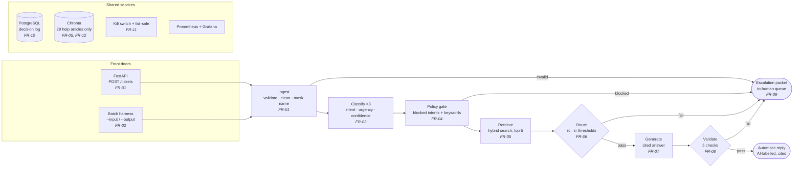

# CloudServe Support Triage

An AI-assisted support system for **CloudServe Solutions**, a cloud infrastructure company whose support team is missing its response-time SLA. The system reads each incoming ticket, answers it automatically when it can do so safely and with cited sources, and otherwise hands it to a human with a complete summary attached.

> **Project status (7 November 2026):** ticket intake (FR-01) and the batch harness (FR-02) are built and tested. Classification, retrieval, routing, generation and validation are designed and specified, and are being built next. See [Build status](#build-status).

---

## Contents

1. [The problem](#the-problem)
2. [What the system does](#what-the-system-does)
3. [Architecture](#architecture)
4. [How a ticket flows through the system](#how-a-ticket-flows-through-the-system)
5. [Technology stack](#technology-stack)
6. [Project structure](#project-structure)
7. [Getting started](#getting-started)
8. [Running the system](#running-the-system)
9. [Reason codes](#reason-codes)
10. [Error handling](#error-handling)
11. [Safety, privacy and governance](#safety-privacy-and-governance)
12. [Testing](#testing)
13. [Build status](#build-status)
14. [Requirements traceability](#requirements-traceability)
15. [Known limitations](#known-limitations)
16. [Project documents](#project-documents)

---

## The problem

CloudServe receives 500+ support tickets a week through four channels (email, chat, documentation comments and a community forum), handled by six agents. First replies take 8 to 12 hours against a 2-hour SLA, and customer satisfaction is falling.

The client asked for a chatbot. Analysis of 500 historical tickets and five stakeholder interviews showed the real problem is different:

| Finding | Evidence |
|---|---|
| **The answers already exist.** 71.4% of tickets are answerable from CloudServe's own 29 help articles. | `answerable_from_docs` label |
| **Tier 1 is already fast.** Tickets resolved at first contact close in a median of **32 minutes**. | `resolution_time_minutes` |
| **Escalation is where time is lost.** Escalated tickets take a median of **745 minutes (about 12.5 hours)**, have lower satisfaction (2.63 vs 3.41), and account for **every** repeat contact. | `escalated`, `csat_rating`, `repeat_contact` |
| **Half of escalations were unnecessary.** 49% of escalated tickets had an answer in the documentation. | `escalated` and `answerable_from_docs` |
| **Urgency is ignored.** High-urgency tickets are handled no faster than low-urgency ones. | `urgency` vs resolution time |
| **The highest-paying customers get the slowest service.** Enterprise: 63% escalated, median 369 min. Business: 52%, 141 min. | `customer_tier` |

**Problem statement:** CloudServe isn't short of answers; it's short of a way to reach them. Fixing response time alone won't help. What has to change is how many tickets are settled the first time, and how much context comes with the ones that genuinely need a senior engineer.

---

## What the system does

For every ticket, the system makes exactly one of two decisions, and records why.

**Answer automatically**, only when all of these hold:
- the ticket is not in a category that must always go to a human (security incidents, compliance requests, feature requests, unclear requests);
- the classifier is confident about what the customer is asking;
- a relevant help article was found;
- the drafted answer passes every safety check before it is sent.

Every automatic answer cites the help article behind each claim and is labelled as AI-drafted.

**Escalate to a human**, in every other case, with an escalation packet so the engineer never has to re-read the thread or re-ask the customer:
- a summary of three sentences or fewer;
- the predicted intent, urgency and confidence;
- the help articles found and a draft answer, where possible;
- a specific list of what the system was unsure about;
- the reason code for escalating.

Escalated tickets are queued by **urgency, then customer tier, then age**, not by age alone.

**Design principle:** the system would rather say nothing than say something wrong. Every safety rule is enforced by code, not by asking a language model to behave.

---

## Architecture



### Three layers

| Layer | Contents | Why it is separate |
|---|---|---|
| **Application** | FastAPI endpoint, batch harness, LangGraph orchestration, guardrails, response formatting | Owns the decision flow and every safety rule |
| **Model and retrieval** | Classifier, embedding model, Chroma vector store, answer generator, claim checker | Can be swapped (another model or vector store) through configuration, without touching the application layer |
| **Persistence and observability** | PostgreSQL decision log, Prometheus metrics, Grafana dashboards, GitHub Actions CI | Every decision is reconstructable and every run is measurable |

### Key design decisions

| Decision | Reason |
|---|---|
| **Safety rules are code, not prompts.** Six of the twelve requirements use no language model at all. | A rule such as "never auto-answer a security incident" must not depend on a model following instructions. |
| **Confidence comes from agreement, not self-rating.** The classifier runs three times; confidence is the share of runs that agree. | Models are poor at rating their own certainty, and the brief requires confidence calibrated within 5 points. |
| **Hybrid retrieval** (meaning-based plus keyword search). | Keyword search fails on "my deployment keeps dying" vs "container health check failures", the documentation owner's main complaint. Meaning-based search alone misses exact error codes. |
| **Answers only from the 29 reviewed articles.** Never from agents' private answer files or past replies. | Tier 2 reports that private snippets contain answers that have been wrong for two years. |
| **Two front doors, one pipeline.** The API and the harness both call the same `handle()` function. | Live and batch tickets can never behave differently. |
| **Thresholds are chosen from data, not judgement.** | A sweep on development tickets sets τc and τr, keeping wrong automatic answers at 5% or below of automatic replies. |

---

## How a ticket flows through the system

| Step | What happens | Requirement | Status |
|---|---|---|---|
| **1. Ingest** | Validates the ticket against the schema. Email: removes quoted replies and signatures. Tidies whitespace. Replaces the customer's name with `[CUSTOMER]`, so no name reaches an external model. Joins subject and body into one text. Fingerprints the original ticket for the log. | FR-01 | **Built** |
| **2. Classify** | Runs the classifier prompt three times. Majority vote gives intent (one of 22) and urgency; agreement gives confidence. Non-fluent tickets are first restated in plain English. | FR-03 | Specified |
| **3. Policy gate** | Pure code. Blocks the four never-automate intents, any ticket matching the keyword safety net in `config/never_auto.yaml` (catches 94% of these tickets on development data even if the classifier is wrong), and short tickets that name no product or error. | FR-04 | Specified |
| **4. Retrieve** | Searches the 29 help articles, split into sections with resolution steps kept whole. Combines MiniLM embeddings in Chroma with BM25 keyword search by reciprocal rank fusion. Returns the top 5 passages. | FR-05 | Specified |
| **5. Route** | Answers automatically only if not blocked, intent confidence ≥ τc and retrieval score ≥ τr. A stricter τc applies to data residency and billing disputes. Assigns exactly one reason code. | FR-06 | Specified |
| **6. Generate** | Writes an answer using only the retrieved passages, as JSON with each claim tied to an article ID. Returns "not answerable" rather than guessing. The AI-drafted label is added by code. | FR-07 | Specified |
| **7. Validate** | Five checks before sending: no private data; citations only from retrieved articles; no promises of refunds, fixes or dates, and no requests for credentials; no advice for a plan the customer isn't on; tone and length per channel. A separate claim-checker model confirms each claim is supported. Any failure escalates. | FR-08 | Specified |
| **8. Escalate** | Builds the escalation packet and places it in the human queue by urgency, tier and age. | FR-09 | Specified |
| **Always** | Logs every decision; escalates instead of failing if the model is unavailable; one switch sends every ticket to a human. | FR-10, FR-11 | Specified |

---

## Technology stack

All free and open source, as the brief requires.

| Purpose | Technology |
|---|---|
| Language and packaging | Python 3.11, managed with [uv](https://docs.astral.sh/uv/) |
| Data validation | Pydantic v2 |
| API | FastAPI, served by Uvicorn |
| Orchestration | LangGraph (on LangChain) |
| Language model | Groq, `llama-3.3-70b-versatile` (classification, generation); `llama-3.1-8b-instant` (claim checking). Configurable. |
| Embeddings | `sentence-transformers/all-MiniLM-L6-v2` |
| Vector store | Chroma |
| Keyword search | BM25 |
| Decision log | PostgreSQL (in Docker), through SQLAlchemy |
| Monitoring | Prometheus and Grafana |
| Testing and CI | pytest, httpx; GitHub Actions |

---

## Project structure

```
CloudServe-Support/
├── src/cloudserve_support/
│   ├── app/
│   │   ├── main.py            FastAPI app: POST /tickets, GET /health
│   │   └── schemas.py         TicketIn, NormalisedTicket, TicketResult, ReasonCode
│   ├── pipeline/
│   │   ├── ingest.py          validation, email cleaning, name masking
│   │   └── graph.py           handle(): the per-ticket error boundary and pipeline
│   ├── harness/
│   │   └── __main__.py        batch runner: --input / --output / --resume / --limit
│   ├── errors.py              error classes, each mapped to a reason code
│   └── logging_config.py      shared logging setup
├── tests/
│   ├── test_ingest.py         FR-01
│   ├── test_harness.py        FR-02 and the API
│   └── test_errors.py         error boundary and API error handling
├── data/                      development, validation and documentation JSON
├── prompts/                   versioned prompt files (PR-01 to PR-04)
├── pyproject.toml
├── uv.lock
└── README.md
```

Planned additions as the build continues: `pipeline/classify.py`, `policy.py`, `retrieve.py`, `route.py`, `generate.py`, `validate.py`; `store/` (decision log); `eval/` (evaluation harness and fairness audit); `config/never_auto.yaml`; `docker-compose.yml`; `.env.example`; `.github/workflows/ci.yml`.

---

## Getting started

### Prerequisites

- [uv](https://docs.astral.sh/uv/getting-started/installation/) (installs Python 3.11 automatically if needed)
- Docker, once the PostgreSQL decision log is added
- A free Groq API key, once classification is added

### Install

```bash
git clone <repository-url>
cd CloudServe-Support
uv sync
```

`uv sync` reads `uv.lock` and recreates the exact environment, including the project package itself.

### Check the install

```bash
uv run python -c "import cloudserve_support.app, cloudserve_support.pipeline, cloudserve_support.harness; print('ok')"
uv run pytest
```

### Configuration

Settings are read from environment variables, or from a `.env` file that is never committed.

| Variable | Purpose | Default |
|---|---|---|
| `LOG_LEVEL` | `DEBUG`, `INFO`, `WARNING` or `ERROR` | `INFO` |
| `GROQ_API_KEY` | Model provider key *(needed from FR-03)* | none |
| `LLM_MODEL` | Model for classification and generation *(from FR-03)* | `llama-3.3-70b-versatile` |
| `DATABASE_URL` | PostgreSQL connection for the decision log *(from FR-10)* | none |
| `KILL_SWITCH` | `true` sends every ticket to a human *(from FR-11)* | `false` |

---

## Running the system

### Batch harness

Processes a whole ticket file unattended. This is the command used for evaluation, including the hidden test set.

```bash
uv run python -m cloudserve_support.harness \
    --input data/validation_tickets.json \
    --output out/results.json
```

| Option | Purpose |
|---|---|
| `--input` | JSON file of tickets (a list, or an object with a `tickets` list). Required. |
| `--output` | Where to write results. Folders are created if missing. Required. |
| `--resume` | Continue an interrupted run without redoing finished tickets. |
| `--limit N` | Process only the first N tickets, for quick checks. |

**Guarantees:** no hardcoded paths; exactly one result per input ticket, in input order; one bad ticket never stops the run; progress saved after every ticket; output written atomically (complete or absent).

### API

```bash
uv run uvicorn cloudserve_support.app.main:app --reload
```

Then open <http://localhost:8000/docs> to send a ticket from the browser.

| Endpoint | Purpose |
|---|---|
| `POST /tickets` | Submit one ticket in the dataset schema; returns a `TicketResult` |
| `GET /health` | Returns `{"status": "ok"}` |

Example request:

```bash
curl -X POST http://localhost:8000/tickets \
  -H "Content-Type: application/json" \
  -d '{
    "ticket_id": "T-1",
    "channel": "chat",
    "subject": "",
    "body": "Our deployment keeps rolling back after the health check.",
    "received_at": "2026-03-14T09:22:00Z",
    "customer_id": "CUST-1",
    "customer_name": "Priya Sharma",
    "customer_tier": "business",
    "customer_region": "europe",
    "language_fluency": "fluent"
  }'
```

### Output format

One `TicketResult` per ticket:

| Field | Meaning |
|---|---|
| `ticket_id` | From the input; `UNKNOWN` if the input had none |
| `route` | `auto_respond` or `escalate` |
| `reason_code` | Why (see [Reason codes](#reason-codes)) |
| `intent`, `urgency`, `intent_confidence` | Classifier output |
| `doc_ids` | Help articles used |
| `response` | The automatic reply, if any |
| `packet` | The escalation packet, if escalated |
| `failed_check` | Which validation check failed, if any |
| `detail` | Short technical explanation, never ticket text |
| `received_at`, `responded_at` | For measuring time to first reply |

> Until classification is built, the placeholder pipeline escalates every valid ticket with `LOW_CONFIDENCE`. Results from these runs are not meaningful and should not be reported.

---

## Reason codes

Every ticket gets exactly one. The same codes are used in results, escalation packets, the decision log and monitoring.

| Code | Meaning |
|---|---|
| `AUTO_RESPONDED` | Answered automatically; every condition and check passed |
| `POLICY_BLOCKED` | Intent is one of the four never-automate intents |
| `KEYWORD_BLOCKED` | The keyword safety net matched, whatever the classification |
| `LOW_CONFIDENCE` | Intent confidence below τc |
| `WEAK_RETRIEVAL` | No article scored above τr, or the generator found the articles don't answer the question |
| `SENSITIVE_CLASS` | Data residency or billing dispute below the stricter threshold |
| `VALIDATION_FAILED` | The draft failed a pre-send check (named in `failed_check`) |
| `MODEL_UNAVAILABLE` | Model call timed out or failed after retries |
| `KILL_SWITCH` | Kill switch on; every ticket goes to a human |
| `INVALID_INPUT` | The ticket failed schema validation |
| `PIPELINE_ERROR` | An unexpected internal error; full traceback in the log |

---

## Error handling

Errors are handled at three levels, so the system always returns a result and never silently drops a ticket.

**1. Known errors carry their own reason code** (`errors.py`). `InvalidTicket` becomes `INVALID_INPUT`, `ModelUnavailable` becomes `MODEL_UNAVAILABLE`, `PipelineError` becomes `PIPELINE_ERROR`. New pipeline steps raise these, and the right code follows automatically.

**2. One error boundary per ticket** (`handle()` in `pipeline/graph.py`). Known errors become escalations with their code. Anything else is treated as a bug: it becomes `PIPELINE_ERROR` and the full traceback is logged. `handle()` never raises.

**3. Run-level and request-level failures:**

| Where | Situation | Result |
|---|---|---|
| API | Body missing or not valid JSON | 200, `INVALID_INPUT` (not a bare 422) |
| API | Unexpected server error | 500, with the normal result shape and `PIPELINE_ERROR` |
| Harness | Finished | Exit code **0** |
| Harness | Bad arguments, missing or unreadable input, invalid JSON | Exit code **2**, one-line message |
| Harness | Output can't be written | Exit code **3**, progress kept for `--resume` |
| Harness | Interrupted (Ctrl+C) | Exit code **130**, progress kept for `--resume` |
| Harness | `--output` is the same file as `--input`, or a folder | Refused, exit code 2 |
| Harness | `--resume` with progress from a different input file | Old progress discarded, fresh start |

**Privacy rule for errors:** error details contain only field names and error types, never ticket text, because they are stored in the decision log.

---

## Safety, privacy and governance

| Control | How it is enforced |
|---|---|
| Never auto-answer security, compliance, feature or unclear requests | Code rule on intent, plus a keyword safety net independent of the classifier |
| No customer names sent to external models | Masked at ingest; tested |
| No customer names stored | Not present in `NormalisedTicket` or the decision log |
| No private data in replies | Pattern check on every outgoing reply |
| No unsupported claims | Citations checked against retrieved articles; separate claim-checker model |
| No promises about refunds, fixes or dates; never ask for credentials | Banned-claims check |
| Every decision explainable | Decision log with input fingerprint, prediction, confidence, sources, action, reason, prompt version and model |
| Past decisions cannot be altered | Database user has insert-only permission on the log |
| Fail safe | Model unavailable means escalate; kill switch escalates everything |
| Fairness | Results segmented by tier, region and language fluency; target gap under 5 points |
| Prompt injection | Ticket text placed inside tags and declared as data; output must be strict JSON validated by code; routing decided by code |
| No secrets in the repository | `.env` ignored by git; secret scanning in CI |

---

## Testing

```bash
uv run pytest -v
```

**37 tests, all passing.** Test names include the test case IDs from the traceability table (for example `test_tc_02_03_bad_tickets_do_not_stop_run`).

| File | Covers |
|---|---|
| `test_ingest.py` | TC-01-01 to TC-01-04: every channel converts; empty chat subject; malformed tickets rejected; names masked; email cleaning; all 500 development tickets convert |
| `test_harness.py` | TC-02-01 to TC-02-04: 500 in, 500 out; temporary paths through the real command line; bad and crashing tickets don't stop the run; resume after interruption. TC-01-05: the API returns a decision. Plus run-level errors and exit codes. |
| `test_errors.py` | Error boundary: unexpected errors become `PIPELINE_ERROR`; known errors keep their code; numeric ticket IDs; error details never contain ticket text; API handling of invalid JSON, empty bodies and server errors |

---

## Build status

| Requirement | Description | Status |
|---|---|---|
| FR-01 | Accept tickets from all four channels; one internal format | ✅ Built, tested |
| FR-02 | Unattended batch harness with input and output paths | ✅ Built, tested |
| FR-03 | Intent and urgency with calibrated confidence | Specified |
| FR-04 | Policy gate for never-automate tickets | Specified |
| FR-05 | Hybrid retrieval over the 29 articles | Specified (next) |
| FR-06 | Routing with data-driven thresholds | Specified |
| FR-07 | Grounded, cited, AI-labelled answers | Specified |
| FR-08 | Pre-send validation checks | Specified |
| FR-09 | Escalation packet and priority queue | Specified |
| FR-10 | PostgreSQL decision log | Specified |
| FR-11 | Fail-safe and kill switch | Specified |
| FR-12 | No private answer files as a source *(Will not)* | Enforced by design |

---

## Requirements traceability

Every component traces back to a requirement, and every requirement traces back to discovery evidence.

| Requirement | Code | Prompt | Tests |
|---|---|---|---|
| FR-01 | `pipeline/ingest.py`, `app/main.py`, `app/schemas.py` | none | TC-01-01 to TC-01-05 |
| FR-02 | `harness/__main__.py`, `pipeline/graph.py` | none | TC-02-01 to TC-02-04 |
| FR-03 | `pipeline/classify.py` *(planned)* | PR-01 | TC-03-01 to TC-03-04 |
| FR-04 | `pipeline/policy.py` *(planned)* | PR-01 (unclear only) | TC-04-01 to TC-04-04 |
| FR-05 | `pipeline/retrieve.py` *(planned)* | none | TC-05-01 to TC-05-03 |
| FR-06 | `pipeline/route.py` *(planned)* | none | TC-06-01 to TC-06-04 |
| FR-07 | `pipeline/generate.py` *(planned)* | PR-02; evaluated by PR-05, PR-06 | TC-07-01 to TC-07-04 |
| FR-08 | `pipeline/validate.py` *(planned)* | PR-04; evaluated by PR-05 | TC-08-01 to TC-08-06 |
| FR-09 | `pipeline/escalate.py` *(planned)* | PR-03 | TC-09-01 to TC-09-04 |
| FR-10 | `store/decision_log.py` *(planned)* | none | TC-10-01 to TC-10-04 |
| FR-11 | `pipeline/graph.py`, model wrapper *(planned)* | none | TC-11-01, TC-11-02 |

### Targets

| Measure | Baseline | Target |
|---|---|---|
| First contact resolution | 43.8% | 60% or above (ceiling 62.2% given the client's own routing labels) |
| Time to first reply | 8–12 hours (reported) | Under 5 minutes for automatic replies |
| Customer satisfaction | 2.97 / 5 | 4.0 or above (proxy score before launch) |
| Escalation rate | 56.2% | 40% or below (the labels require 37.8%) |
| Repeat contacts | 21.6% | About 11% |
| Unsafe automatic replies | Not measured today | Zero |
| Gap between customer groups | Up to 20 points | Under 5 points |

---

## Known limitations

- **Only the intake and harness are built.** Results produced before classification exists are placeholders.
- **Masking and email cleaning are tested only on made-up examples.** None of the 500 development tickets contains a customer name or a quoted email thread.
- **Routing accuracy has a ceiling below 100%.** 35 of 78 repeated ticket texts carry different routing labels in the data.
- **Urgency labels are inconsistent** (67 of 78 repeated texts disagree), so no urgency accuracy target is set.
- **Article freshness can't be checked:** every article shows `last_reviewed_days_ago = 0`.
- **Reference answers are weak for 40% of tickets:** 79 of 200 are one generic paragraph, so they are excluded when scoring answer quality.
- **The human queue is a sorted list in the output,** not an agent interface.

### Revision log (changes since PRD v1.0)

| # | Change | Reason |
|---|---|---|
| 1 | Added reason code `INVALID_INPUT` | FR-01 escalates malformed tickets, but PRD v1.0 had no code for it |
| 2 | Added reason code `PIPELINE_ERROR` | No existing code covered an unexpected internal error |

---

## Project documents

| Stage | Document | Status |
|---|---|---|
| 1 | Discovery workbook: interviews, data analysis, problem statement | Complete |
| 2 | Product requirements document (PRD v1.0): 12 functional and 10 non-functional requirements | Complete |
| 3 | Prompt library: specifications, prompt register PR-01 to PR-08, traceability | Complete |
| 4 | Sprint plan | In progress |
| 5 | Build, evaluation and revised PRD | In progress |
| 6 | Report, video and effort log | Not started |

---

## Acknowledgements

Built as the capstone project for the Forward Deployed AI Engineering programme. CloudServe Solutions and all its stakeholders are fictional. Parts of the code and documentation were drafted with an AI assistant (Claude) and reviewed, tested and edited by the author, as the brief requires.