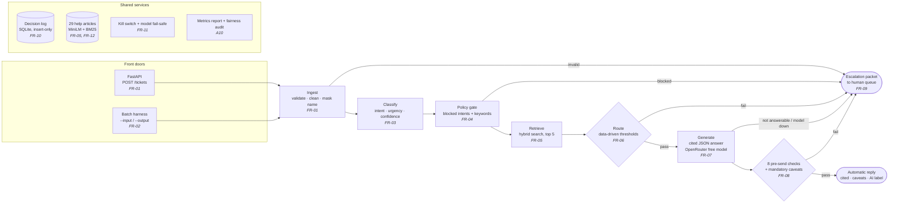

# CloudServe Support Triage

An AI-assisted support system for **CloudServe Solutions**, a cloud infrastructure company whose support team is missing its response-time SLA. The system reads each incoming ticket, answers it automatically when it can do so safely and with cited sources, and otherwise hands it to a human with a complete summary attached.

> **Project status (12 November 2026): build complete.** Every functional requirement (FR-01 to FR-12) is built and tested: 124 tests pass with one command. On the 80 validation tickets, 0 of 14 must-never-automate tickets were answered automatically, every automatic reply carries citations and the AI label, and citation accuracy is 100%. See [Evaluation](#evaluation) and [Build status](#build-status).

---

## Contents

1. [The problem](#the-problem)
2. [What the system does](#what-the-system-does)
3. [Architecture](#architecture)
4. [How a ticket flows through the system](#how-a-ticket-flows-through-the-system)
5. [Technology stack](#technology-stack)
6. [Project structure](#project-structure)
7. [Getting started](#getting-started)
8. [Running the system](#running-the-system)
9. [Evaluation](#evaluation)
10. [Reason codes](#reason-codes)
11. [Error handling](#error-handling)
12. [Safety, privacy and governance](#safety-privacy-and-governance)
13. [Testing](#testing)
14. [Build status](#build-status)
15. [Requirements traceability](#requirements-traceability)
16. [Known limitations](#known-limitations)
17. [Revision log](#revision-log-changes-since-prd-v10)
18. [Project documents](#project-documents)

---

## The problem

CloudServe receives 500+ support tickets a week through four channels (email, chat, documentation comments and a community forum), handled by six agents. First replies take 8 to 12 hours against a 2-hour SLA, and customer satisfaction is falling.

The client asked for a chatbot. Analysis of 500 historical tickets and five stakeholder interviews showed the real problem is different:

| Finding | Evidence |
|---|---|
| **The answers already exist.** 71.4% of tickets are answerable from CloudServe's own 29 help articles. | `answerable_from_docs` label |
| **Tier 1 is already fast.** Tickets resolved at first contact close in a median of **32 minutes**. | `resolution_time_minutes` |
| **Escalation is where time is lost.** Escalated tickets take a median of **745 minutes (about 12.5 hours)**, have lower satisfaction (2.63 vs 3.41), and account for **every** repeat contact. | `escalated`, `csat_rating`, `repeat_contact` |
| **Half of escalations were unnecessary.** 49% of escalated tickets had an answer in the documentation. | `escalated` and `answerable_from_docs` |
| **Urgency is ignored.** High-urgency tickets are handled no faster than low-urgency ones. | `urgency` vs resolution time |
| **The highest-paying customers get the slowest service.** Enterprise: 63% escalated, median 369 min. Business: 52%, 141 min. | `customer_tier` |

**Problem statement:** CloudServe isn't short of answers; it's short of a way to reach them. Fixing response time alone won't help. What has to change is how many tickets are settled the first time, and how much context comes with the ones that genuinely need a senior engineer.

---

## What the system does

For every ticket, the system makes exactly one of two decisions, and records why.

**Answer automatically**, only when all of these hold:
- the ticket is not in a category that must always go to a human (security incidents, compliance requests, feature requests, unclear requests);
- the classifier is confident about what the customer is asking;
- a relevant help article was found;
- the model says the articles answer the question, and its draft passes every pre-send check.

Every automatic answer cites the help article behind each claim, carries any mandatory caveats for the articles it cites, and is labelled as AI-drafted.

**Escalate to a human**, in every other case, with an escalation packet so the engineer never has to re-read the thread or re-ask the customer:
- a short summary;
- the predicted intent, urgency, confidence and the alternatives considered;
- the help articles found and the draft answer, where there is one;
- a specific list of what the system was unsure about;
- the reason code and a suggested first step.

Escalated tickets are queued by **urgency, then customer tier, then age**, not by age alone.

**Design principle:** the system would rather say nothing than say something wrong. Every safety rule is enforced by code, not by asking a language model to behave. The language model is used for one thing only: writing the answer from the articles.

---

## Architecture



### Three layers

| Layer | Contents | Why it is separate |
|---|---|---|
| **Application** | FastAPI endpoint, batch harness, pipeline (`graph.py`), policy gate, routing, pre-send checks, caveats, reply formatting | Owns the decision flow and every safety rule |
| **Model and retrieval** | Classifier, embedding model, vector search, OpenRouter model client with fallback and cache | Can be swapped (another model or vector store) through configuration, without touching the application layer |
| **Persistence and observability** | Decision log, per-run metrics report and fairness audit, GitHub Actions CI | Every decision is reconstructable and every run is measurable |

### Key design decisions

| Decision | Reason |
|---|---|
| **Safety rules are code, not prompts.** The policy gate, routing, pre-send checks, caveats and kill switch use no language model at all. | A rule such as "never auto-answer a security incident" must not depend on a model following instructions. |
| **One model call per answered ticket, and none for any other.** Classification, grounding checks and escalation packets are code. | Deterministic decisions (A5), and the free tier allows only 50 model calls a day. |
| **Classification by nearest-neighbour vote, not a language model.** The 15 most similar labelled development tickets vote on intent and urgency; the winning share becomes a calibrated confidence. | Deterministic, no model calls, and the confidence is measured: held-out intent accuracy 94.8%. |
| **Honest evaluation: duplicate tickets never cross between training and testing.** | Only 216 of the 500 development ticket texts are unique. A first version scored 99.8% because duplicates leaked into the test folds; grouping by text gave the honest 94.8%. |
| **Hybrid retrieval** (meaning-based plus keyword search). | Keyword search fails on "my deployment keeps dying" vs "container health check failures". Meaning-based search alone misses exact error codes. Hybrid recall@5 98.9% vs 96.9% keyword-only. |
| **Only native libraries that run under strict endpoint security.** Embeddings on ONNX Runtime (not PyTorch), vector search in NumPy when Chroma can't load, decision log on Python's built-in `sqlite3` (not SQLAlchemy). | Windows Application Control on the build machine blocked PyTorch, Chroma's gRPC and SQLAlchemy's compiled files. Client machines often have the same controls; turning security off is not an option. |
| **Every failure degrades, nothing stops.** | No embedding model: keyword search. No model provider: escalate with `MODEL_UNAVAILABLE`. Decision log unwritable: the ticket still gets its result (A11). |
| **Answers only from the 29 reviewed articles.** Never from agents' private answer files or past replies (FR-12). | Tier 2 reports that private snippets contain answers that have been wrong for two years. |
| **Mandatory caveats added by code.** | The checks catch unsupported claims but not omitted facts. For 14 articles, the facts a customer must not miss (data loss, access, money, irreversible choices) are appended word for word whenever the article is cited. |
| **Two front doors, one pipeline.** The API and the harness both call the same `handle()` function. | Live and batch tickets can never behave differently. |
| **Thresholds chosen from data, not judgement.** | `eval/retrieval_check.py` set the retrieval threshold (0.30). `eval/threshold_sweep.py` set the confidence threshold (0.80): the lowest value where 99% of automatic answers have the right intent. |
| **Rules in configuration, versioned.** | `config/never_auto.yaml` (policy) and `config/caveats.yaml` (caveats) carry version numbers recorded with every decision. Changing a rule is a reviewable commit. |

---

## How a ticket flows through the system

| Step | What happens | Requirement |
|---|---|---|
| **1. Ingest** | Validates the ticket against the schema. Email: removes quoted replies and signatures. Tidies whitespace. Replaces the customer's name with `[CUSTOMER]`, so no name reaches an external model. Joins subject and body. Fingerprints the input for the log. | FR-01 |
| **2. Classify** | The 15 most similar of the 500 labelled development tickets (TF-IDF) vote on intent (one of 22) and urgency. The vote share becomes a calibrated confidence. Records the top three intents. Empty or unmatched text gets `unclear_request`, confidence 0. | FR-03 |
| **3. Policy gate** | Pure code: (1) the four never-automate intents; (2) a keyword safety net independent of the classifier; (3) tickets of 20 words or fewer that name no product. Flags data residency and billing disputes for a stricter threshold. | FR-04 |
| **4. Retrieve** | Searches the 29 articles, split at their headings into 116 sections. MiniLM embeddings plus BM25, combined by reciprocal rank fusion. Up to 5 passages, one per article, above the relevance threshold (0.30). Runs for every ticket, so escalations carry sources too. | FR-05 |
| **5. Route** | Fixed order: policy gate → relevant passage found → sensitive threshold (0.90) → general threshold (0.80). The first that fails gives the reason code. | FR-06 |
| **6. Generate** | Prompt PR-02 v1.1. The model gets the ticket body and the top 3 articles that apply to the customer's plan (filtered in code), and returns JSON: `answerable`, `answer`, and a citation for each claim. If the JSON is broken it is asked once to resend it. Models are tried in order with fallback, and every response is cached. | FR-07 |
| **7. Check** | Eight code checks, in order: format, citations (only articles given), grounding (each claim matches its article), private data, banned claims (refunds, fixes, dates, asking for credentials), plan, length per channel, tone. The first failure escalates. Then mandatory caveats for the cited articles are added, and the reply is assembled: answer, caveats, sources, AI label. | FR-08 |
| **8. Escalate** | Builds the packet in code and places it in the human queue by urgency, tier and age. | FR-09 |
| **Always** | Every decision is written to the insert-only decision log. | FR-10 |
| **Always** | Kill switch (`KILL_SWITCH=true`) sends every ticket to a human. Model unavailable: escalate. | FR-11 |

---

## Technology stack

All free and open source, as the brief requires.

| Purpose | Technology |
|---|---|
| Language and packaging | Python 3.14 (tested on 3.14.8), managed with [uv](https://docs.astral.sh/uv/) |
| Data validation | Pydantic v2 |
| API | FastAPI, served by Uvicorn |
| Orchestration | A plain Python pipeline (`pipeline/graph.py`), one function per step |
| Classification | Nearest-neighbour vote over TF-IDF similarity, isotonic calibration (scikit-learn) |
| Language model | OpenRouter free models, through `httpx`: `nvidia/nemotron-3.5-lightning:free` first, Gemma 4 as fallbacks. Configurable. |
| Embeddings | `all-MiniLM-L6-v2`, run with ONNX Runtime and `tokenizers` |
| Vector store | Chroma, with an in-memory NumPy store when Chroma can't load |
| Keyword search | BM25 (`rank-bm25`) |
| Configuration | YAML (`pyyaml`), `.env` (`python-dotenv`) |
| Decision log and response cache | SQLite, through Python's built-in `sqlite3` |
| Monitoring | Per-run metrics report (Markdown and JSON) and fairness audit |
| Testing and CI | pytest, httpx; GitHub Actions |

---

## Project structure

```
CloudServe-Support/
├── src/cloudserve_support/
│   ├── app/
│   │   ├── main.py            FastAPI app: POST /tickets, GET /health
│   │   └── schemas.py         TicketIn, NormalisedTicket, TicketResult, ReasonCode
│   ├── pipeline/
│   │   ├── ingest.py          validation, email cleaning, name masking
│   │   ├── classify.py        nearest-neighbour intent and urgency, calibrated confidence
│   │   ├── policy.py          policy gate: blocked intents, keyword net, unclear rule
│   │   ├── retrieve.py        hybrid retrieval over the 29 articles
│   │   ├── route.py           routing decision and plain-language reason
│   │   ├── generate.py        grounded answer from the articles (PR-02), JSON repair
│   │   ├── validate.py        the 8 pre-send checks
│   │   ├── caveats.py         mandatory caveats, checked against the articles at startup
│   │   ├── escalate.py        escalation packet and human queue
│   │   └── graph.py           handle() and process(): the pipeline and its error boundary
│   ├── harness/
│   │   └── __main__.py        batch runner: --input / --output / --resume / --limit
│   ├── llm.py                 OpenRouter client: fallback, retries, rest after 429s, cache
│   ├── decision_log.py        insert-only decision log (FR-10)
│   ├── metrics.py             metrics report and fairness audit (A10)
│   ├── errors.py              error classes, each mapped to a reason code
│   └── logging_config.py      shared logging setup
├── tests/                     124 tests (see Testing)
├── eval/
│   ├── retrieval_check.py     retrieval recall; sets the relevance threshold
│   └── threshold_sweep.py     sets the routing confidence thresholds
├── config/
│   ├── never_auto.yaml        policy gate rules (versioned)
│   └── caveats.yaml           mandatory caveats (versioned)
├── prompts/
│   └── pr02_generator_v1.md   the answer-writing prompt, PR-02 v1.1
├── data/                      development, validation and documentation JSON
├── .github/workflows/tests.yml  CI: tests and a harness smoke run on every push
├── storage/                   response cache and decision log (created at run time, not committed)
├── out/                       harness results, queues and metrics (not committed)
├── .env.example               configuration template (no secrets)
├── .python-version
├── pyproject.toml
├── uv.lock
└── README.md
```

---

## Getting started

### Prerequisites

- [uv](https://docs.astral.sh/uv/getting-started/installation/) (installs Python 3.14 automatically if needed)
- Internet access on first run: the embedding model (about 80 MB) downloads once and is cached in `~/.cache/chroma`
- A free [OpenRouter](https://openrouter.ai) API key, for automatic answers. Without one, everything else runs, and tickets that would be answered escalate with `MODEL_UNAVAILABLE`.

### Install

```bash
git clone <repository-url>
cd CloudServe-Support
uv sync
cp .env.example .env      # then put your own key in .env, never in .env.example
```

Run every command from the project folder. Running pytest from a parent folder makes it search the whole drive.

### Check the install

```bash
uv run python -m pytest -q                          # 124 passed
uv run python -m cloudserve_support.llm --ping      # one test request with your key
```

### Configuration

Settings are read from environment variables, or from a `.env` file that is never committed.

| Variable | Purpose | Default |
|---|---|---|
| `OPENROUTER_API_KEY` | Model provider key | none |
| `LLM_MODELS` | Models to try, in order, comma-separated. Put models from different providers next to each other. | `nvidia/nemotron-3.5-lightning:free,google/gemma-4-31b-it:free,google/gemma-4-26b-a4b-it:free` |
| `LLM_REASONING_EFFORT` | How long reasoning models think before answering | `low` |
| `LLM_COOLDOWN` | Seconds a model is skipped after repeated 429s | `120` |
| `LLM_RETRIES`, `LLM_RETRY_WAIT` | Extra attempts on a temporary 429, and the wait between them | `1`, `8` |
| `LLM_TIMEOUT`, `LLM_MIN_INTERVAL` | Request timeout; minimum seconds between requests (free tier: 20 a minute) | `30`, `3.2` |
| `LLM_CACHE_PATH` | Response cache | `storage/llm_cache.sqlite` |
| `GENERATOR_PROMPT` | Answer-writing prompt | `prompts/pr02_generator_v1.md` |
| `DOCS_PATH` | Help articles | `data/documentation.json` |
| `TRAIN_PATH` | Labelled tickets the classifier votes over | `data/development_tickets.json` |
| `RETRIEVAL_TOP_K`, `RETRIEVAL_MIN_SCORE` | Passages per ticket; relevance threshold | `5`, `0.30` |
| `CLASSIFIER_EMBEDDINGS` | `true` adds MiniLM similarity to the classifier | `false` |
| `POLICY_CONFIG` | Policy gate rules | `config/never_auto.yaml` |
| `CAVEATS_CONFIG` | Mandatory caveats | `config/caveats.yaml` |
| `CONFIDENCE_THRESHOLD` | Minimum intent confidence for an automatic answer | `0.80` |
| `CONFIDENCE_THRESHOLD_SENSITIVE` | Same, for data residency and billing disputes | `0.90` |
| `DATABASE_URL` | Decision log; empty turns it off | `sqlite:///./storage/decisions.db` |
| `KILL_SWITCH` | `true` sends every ticket to a human | `false` |
| `LOG_LEVEL` | `DEBUG`, `INFO`, `WARNING` or `ERROR` | `INFO` |

---

## Running the system

### Batch harness

Processes a whole ticket file unattended. This is the command used for evaluation, including the hidden test set.

```bash
uv run python -m cloudserve_support.harness \
    --input data/validation_tickets.json \
    --output out/validation_results.json
```

| Option | Purpose |
|---|---|
| `--input` | JSON file of tickets (a list, or an object with a `tickets` list). Required. |
| `--output` | Where to write results. Folders are created if missing. Required. |
| `--resume` | Continue an interrupted run without redoing finished tickets. |
| `--limit N` | Process only the first N tickets, for quick checks. |

Each run writes four files:

| File | Contents |
|---|---|
| `<output>.json` | One result per ticket, in input order |
| `<output>.queue.json` | Escalated tickets in human-queue order |
| `<output>.metrics.md` / `.metrics.json` | Volume, Business, Technical and Governance metrics, with the fairness audit |

**Guarantees:** no hardcoded paths; exactly one result per input ticket, in input order; one bad ticket never stops the run; progress saved after every ticket; output written atomically; every decision logged.

> **Running the hidden test set.** Automatic answers need `OPENROUTER_API_KEY`. The free tier allows 50 model requests a day (1,000 after a one-off $10 credit purchase). 120 tickets need roughly 90 requests. If the daily limit is reached, the remaining tickets escalate with `MODEL_UNAVAILABLE`; run the same command again after the limit resets (00:00 UTC), **without** `--resume`: answers already made come from the cache, and only the escalated tickets call the model again.

### API

```bash
uv run uvicorn cloudserve_support.app.main:app --reload
```

Then open <http://localhost:8000/docs> to send a ticket from the browser.

| Endpoint | Purpose |
|---|---|
| `POST /tickets` | Submit one ticket in the dataset schema; returns a `TicketResult` |
| `GET /health` | Returns `{"status": "ok"}` |

### Inspection tools

```bash
uv run python -m cloudserve_support.llm --list-free                 # free models OpenRouter offers now
uv run python -m cloudserve_support.llm --ping                      # one test request with your key
uv run python -m cloudserve_support.decision_log --summary          # decision log totals by reason and run
uv run python -m cloudserve_support.decision_log --ticket VAL-0026  # every decision for one ticket
uv run python -m cloudserve_support.metrics --results out/validation_results.json --tickets data/validation_tickets.json
uv run python eval/retrieval_check.py --tickets data/development_tickets.json
uv run python eval/threshold_sweep.py --tickets data/development_tickets.json
```

### Output format

One `TicketResult` per ticket:

| Field | Meaning |
|---|---|
| `ticket_id` | From the input; `UNKNOWN` if the input had none |
| `route` | `auto_respond` or `escalate` |
| `reason_code`, `reason_text` | Why, as a code (see [Reason codes](#reason-codes)) and in plain language |
| `intent`, `urgency`, `intent_confidence`, `alternatives` | Classifier output and the intents considered |
| `doc_ids`, `retrieval_scores` | Help articles retrieved, with scores |
| `policy_rule`, `policy_version`, `sensitive` | Which policy rule applied, which version of the rules, and any sensitive class |
| `response` | The automatic reply: answer, caveats, sources, AI label |
| `cited_doc_ids`, `caveat_doc_ids` | Articles cited, and articles whose mandatory caveats were added |
| `checks`, `failed_check` | Every pre-send check that ran, and which one failed |
| `model`, `cached`, `prompt_version` | Which model wrote the draft, whether it came from the cache, and the prompt version |
| `packet` | The escalation packet, if escalated |
| `detail` | Short technical explanation, never ticket text |
| `channel`, `customer_tier`, `customer_region`, `language_fluency` | Group fields for the fairness audit (no names or ids) |
| `input_hash` | Fingerprint of the input, linking the result to the decision log |
| `received_at`, `responded_at`, `latency_ms` | Timing; `latency_ms` is used for time to first reply, because replayed historical tickets make `responded_at − received_at` meaningless |

---

## Evaluation

All figures are on the 80 validation tickets unless stated. Settings were chosen on the development tickets; validation was used to confirm. *(Run of 12 November; 13 tickets were waiting for the next day's model quota and are being re-run.)*

| Measure | Result |
|---|---|
| Must-never-automate tickets answered automatically | **0 of 14** |
| Automatic replies with citation, AI label and all checks passed | **100%** |
| Citation accuracy (cited article is one the labels expect) | **100%** |
| Automation rate | 51% (about 256 tickets a week off the human queue) |
| Escalations with a complete packet | 100% |
| Intent accuracy | 94.8% held out on development (validation shows 100%, inflated by reused templates) |
| Retrieval: expected article found / ranked first | 98% / 96% |
| Route agreement with the client's labels | 66% (limited by label noise, below) |
| Urgency agreement | 41% (labels inconsistent; no target set) |
| Drafts stopped before reaching a customer | 8: the model said the articles don't answer (5); a check failed (3: grounding 1, format 2) |

**Manual review of automatic answers.** 14 of the 41 automatic replies were checked against their articles by hand, including all 9 that the labels mark as "docs cannot answer":
- 12 correct and grounded. 7 of the 9 flagged tickets are label noise: the articles do answer them (for example VAL-0060, webhook signatures over the raw body, DOC-API-003).
- 1 accurate but missing the customer's point (VAL-0025: suggests a setting the customer had already changed).
- 1 grounded but incomplete (VAL-0026, data residency for a contract: left out that metadata is stored centrally). This led to the mandatory caveats.
- 0 invented facts.

**Latency** is reported by path, because one number hides the difference:

| Path | Typical time |
|---|---|
| Blocked by policy (no model call) | under 10 ms |
| Answer from the response cache | under 15 ms |
| Fresh call to a free model | 29–37 s |

The 3-second p95 target holds for every path except fresh free-model calls. Free models are shared and slow; a paid model or a dedicated deployment would be needed to meet it in production.

**Fairness.** Automation rates are compared, for each tier, region, fluency and channel, with the rate that group's own labels call for, so differences in ticket mix are not mistaken for unfairness. Groups more than 15 points below their expected rate are flagged in the metrics report.

---

## Reason codes

Every ticket gets exactly one. The same codes are used in results, escalation packets, the decision log and the metrics report.

| Code | Meaning |
|---|---|
| `AUTO_RESPONDED` | Answered automatically; every condition and check passed |
| `POLICY_BLOCKED` | Never-automate intent, or a short ticket naming no product |
| `KEYWORD_BLOCKED` | The keyword safety net matched, whatever the classification |
| `LOW_CONFIDENCE` | Intent confidence below the threshold (0.80) |
| `WEAK_RETRIEVAL` | No article passed the relevance threshold, or the model found the articles don't answer the question |
| `SENSITIVE_CLASS` | Data residency or billing dispute below the stricter threshold (0.90) |
| `VALIDATION_FAILED` | The draft failed a pre-send check (named in `failed_check`) |
| `MODEL_UNAVAILABLE` | No model could be reached (busy, daily limit, no key) |
| `KILL_SWITCH` | Kill switch on; every ticket goes to a human |
| `INVALID_INPUT` | The ticket failed schema validation |
| `PIPELINE_ERROR` | An unexpected internal error; full traceback in the log |

---

## Error handling

Errors are handled at three levels, so the system always returns a result and never silently drops a ticket.

**1. Known errors carry their own reason code** (`errors.py`). `InvalidTicket` becomes `INVALID_INPUT`, `ModelUnavailable` becomes `MODEL_UNAVAILABLE`, `PipelineError` becomes `PIPELINE_ERROR`.

**2. One error boundary per ticket** (`handle()` in `pipeline/graph.py`). Known errors become escalations with their code. Anything else becomes `PIPELINE_ERROR` with the traceback logged. `handle()` never raises.

**3. Model provider failures** (`llm.py`): models are tried in order; a temporary 429 is retried once, then the model is rested for `LLM_COOLDOWN` seconds; a reasoning model that runs out of tokens is retried with twice the allowance; the daily limit stops further requests for the run. Anything that still fails escalates with `MODEL_UNAVAILABLE`.

**4. Run-level and request-level failures:**

| Where | Situation | Result |
|---|---|---|
| API | Body missing or not valid JSON | 200, `INVALID_INPUT` (not a bare 422) |
| API | Unexpected server error | 500, with the normal result shape and `PIPELINE_ERROR` |
| Harness | Finished | Exit code **0** |
| Harness | Bad arguments, missing or unreadable input, invalid JSON | Exit code **2**, one-line message |
| Harness | Output can't be written | Exit code **3**, progress kept for `--resume` |
| Harness | Interrupted (Ctrl+C) | Exit code **130**, progress kept for `--resume` |
| Anywhere | Decision log can't be written | Error logged; the ticket still gets its result |
| Startup | A caveat no longer matches its article | Refuses to start the pipeline; every ticket escalates |

**Privacy rule for errors:** error details contain only field names and error types, never ticket text, because they are stored in the decision log.

---

## Safety, privacy and governance

| Control | How it is enforced |
|---|---|
| Never auto-answer security, compliance, feature or unclear requests | Code rule on intent, plus a keyword safety net independent of the classifier |
| No customer names sent to external models | Masked at ingest; tested |
| No customer names or ids stored | Not in `NormalisedTicket`, the results or the decision log; tested |
| No private data in replies | Pattern check on every outgoing reply |
| No unsupported claims | Citations must be articles the model was given; each claim must match its article (grounding check) |
| No important omissions | Mandatory caveats added by code, word for word from the articles |
| No promises about refunds, fixes or dates; never ask for credentials | Banned-claims check |
| AI-drafted replies are labelled | Label added by code to every automatic reply; measured at 100% |
| Every decision explainable | Decision log: input fingerprint, prediction, confidence, sources, route, reason, model, prompt and policy versions, latency |
| Past decisions cannot be altered | Database triggers refuse UPDATE and DELETE on the decision log; tested |
| Fail safe | Model unavailable means escalate; kill switch escalates everything |
| Fairness | Automation and accuracy by tier, region, fluency and channel in every metrics report |
| Prompt injection | Ticket text placed inside tags and declared as data; output must be strict JSON validated by code; routing decided by code before the model runs |
| No secrets in the repository | `.env` ignored by git; `.env.example` holds placeholders only; tests and CI run with a blank key |

---

## Testing

```bash
uv run python -m pytest -q
```

**124 tests, all passing, with no network calls to the model** (`tests/conftest.py` blanks the key and points the cache and decision log at temporary files). Test names include the test case IDs from the traceability table. The same command runs in GitHub Actions on every push, followed by a 20-ticket harness smoke run.

| File | Covers |
|---|---|
| `test_ingest.py` | TC-01-01 to TC-01-04: channels, empty subjects, malformed tickets, name masking, email cleaning |
| `test_harness.py` | TC-02-01 to TC-02-04 and TC-01-05: one result per ticket, paths from the command line, bad tickets, resume, exit codes, the API |
| `test_errors.py` | The error boundary and API error handling |
| `test_classify.py` | TC-03-01 to TC-03-04: outputs, determinism, fallback, held-out accuracy ≥ 85% |
| `test_policy.py` | TC-04-01 to TC-04-04: no must-never ticket passes; the keyword net works without the classifier |
| `test_retrieve.py` | TC-05-01 to TC-05-03: recall, corpus only, sections never split, relevance threshold, fallbacks |
| `test_route.py` | TC-06: every routing branch, thresholds from configuration, determinism (A5), kill switch (TC-11-02) |
| `test_generate.py` | TC-07, TC-08, TC-09, TC-11-01: cited and labelled replies, not-answerable, each check failing when it should, packets, queue order, model fallback, retries, rest after 429s, token retry, JSON repair, cache |
| `test_caveats.py` | Caveats must match their articles or startup stops; the VAL-0026 case carries its caveats |
| `test_decision_log.py` | TC-10-01 to TC-10-04: every decision logged, no personal data, insert-only, a log failure never loses a ticket |
| `test_metrics.py` | A10: four sections, label-based accuracy and safety, latency paths, fairness against expected rates |

---

## Build status

| Requirement | Description | Status |
|---|---|---|
| FR-01 | Accept tickets from all four channels; one internal format | ✅ Built, tested |
| FR-02 | Unattended batch harness with input and output paths | ✅ Built, tested |
| FR-03 | Intent and urgency with calibrated confidence | ✅ Built, tested; held-out intent accuracy 94.8% |
| FR-04 | Policy gate for never-automate tickets | ✅ Built, tested; 0 of 14 validation tickets got through |
| FR-05 | Hybrid retrieval over the 29 articles | ✅ Built, tested; recall@5 98.9% |
| FR-06 | Routing with data-driven thresholds | ✅ Built, tested |
| FR-07 | Grounded, cited, AI-labelled answers | ✅ Built, tested |
| FR-08 | Pre-send checks | ✅ 8 checks plus mandatory caveats |
| FR-09 | Escalation packet and priority queue | ✅ Built, tested |
| FR-10 | Decision log | ✅ Built, tested; insert-only |
| FR-11 | Fail-safe and kill switch | ✅ Built, tested |
| FR-12 | No private answer files as a source *(Will not)* | ✅ Enforced by design: only `data/documentation.json` is indexed |

---

## Requirements traceability

Every component traces back to a requirement, and every requirement traces back to discovery evidence.

| Requirement | Code | Prompt | Tests |
|---|---|---|---|
| FR-01 | `pipeline/ingest.py`, `app/main.py`, `app/schemas.py` | none | TC-01-01 to TC-01-05 |
| FR-02 | `harness/__main__.py`, `pipeline/graph.py` | none | TC-02-01 to TC-02-04 |
| FR-03 | `pipeline/classify.py` | none (PR-01 replaced; revision 7) | TC-03-01 to TC-03-04 |
| FR-04 | `pipeline/policy.py`, `config/never_auto.yaml` | none | TC-04-01 to TC-04-04 |
| FR-05 | `pipeline/retrieve.py` | none | TC-05-01 to TC-05-03 |
| FR-06 | `pipeline/route.py`, `eval/threshold_sweep.py` | none | TC-06 |
| FR-07 | `pipeline/generate.py`, `llm.py` | PR-02 v1.1 | TC-07 |
| FR-08 | `pipeline/validate.py`, `pipeline/caveats.py`, `config/caveats.yaml` | none at runtime (PR-04 replaced; revision 12) | TC-08, `test_caveats.py` |
| FR-09 | `pipeline/escalate.py` | none at runtime (PR-03 replaced; revision 13) | TC-09 |
| FR-10 | `decision_log.py` | none | TC-10-01 to TC-10-04 |
| FR-11 | `pipeline/graph.py`, `llm.py` | none | TC-11-01, TC-11-02 |
| A10 | `metrics.py` | none | `test_metrics.py` |

### Targets

| Measure | Baseline | Target |
|---|---|---|
| First contact resolution | 43.8% | 60% or above (ceiling 62.2% given the client's own routing labels) |
| Time to first reply | 8–12 hours (reported) | Under 5 minutes for automatic replies |
| Customer satisfaction | 2.97 / 5 | 4.0 or above (proxy score before launch) |
| Escalation rate | 56.2% | 40% or below (the labels require 37.8%) |
| Repeat contacts | 21.6% | About 11% |
| Unsafe automatic replies | Not measured today | Zero |
| Gap between customer groups | Up to 20 points | Under 5 points |

---

## Known limitations

- **Free models are slow and rationed.** Fresh answers take about 30 seconds, and the free tier allows 50 requests a day. The cache makes repeat runs free; production would need a paid model.
- **The pre-send checks catch unsupported claims, not every omission.** Mandatory caveats cover the 14 articles where an omission is costly; elsewhere an answer can still be incomplete (VAL-0025).
- **The caveats were added after reviewing validation results,** so they are tuned on validation; the hidden test set is where they are confirmed.
- **About a third of automatic routes disagree with the client's labels.** Manual review shows most of these are label noise (the articles do answer them), but not all.
- **Validation intent accuracy (100%) overstates real accuracy,** because validation reuses development message templates. 94.8% (held out by text) is the honest figure.
- **The keyword lists were tuned on development tickets.** Validation was used only to confirm (14 of 14 caught).
- **Exposed-key tickets are escalated on purpose** (DOC-SEC-002 treats an exposed credential as a security event), at the cost of 4 validation tickets the labels say could be answered.
- **Urgency labels are inconsistent** (67 of 78 repeated texts disagree); measured agreement is 41%, which matters because urgency orders the human queue.
- **Routing accuracy has a ceiling below 100%.** 35 of 78 repeated ticket texts carry different routing labels.
- **Masking and email cleaning are tested only on made-up examples.** No development ticket contains a customer name or a quoted email thread.
- **Article freshness can't be checked:** every article shows `last_reviewed_days_ago = 0`.
- **The human queue is a sorted list in the output,** not an agent interface.
- **No live dashboards.** Monitoring is a metrics report per run, not Prometheus and Grafana.
- **The decision log is SQLite.** PostgreSQL in production needs the same table and a database user with INSERT and SELECT only.

---

## Revision log (changes since PRD v1.0)

| # | Change | Reason |
|---|---|---|
| 1 | Added reason code `INVALID_INPUT` | FR-01 escalates malformed tickets, but PRD v1.0 had no code for it |
| 2 | Added reason code `PIPELINE_ERROR` | No existing code covered an unexpected internal error |
| 3 | Time to first reply measured as the system's own processing time (`latency_ms`) | Tickets are historical, replayed today, so `responded_at − received_at` is meaningless |
| 4 | Embeddings run on ONNX Runtime instead of sentence-transformers | Windows Application Control blocked PyTorch; same model, much smaller install |
| 5 | Retrieval falls back to keyword-only search if the embedding model can't load | Degrade rather than stop (A11) |
| 6 | Retrieval score is a relevance filter only; answerability decided by policy gate, confidence and the generator | Unanswerable tickets score almost as high as answerable ones |
| 7 | Classifier replaced: nearest-neighbour vote instead of three samples of PR-01 | A5 requires the same decision every time; free tier allows 50 calls a day; confidence is measured, not self-rated |
| 8 | The confidence threshold controls intent accuracy; answerability is decided by the generator | Raising the threshold did not reduce disagreement with the "not answerable" labels |
| 9 | Exposed-key tickets escalated deliberately by the keyword net | DOC-SEC-002 treats an exposed credential as a security event |
| 10 | No urgency accuracy target | Urgency labels are inconsistent for identical texts |
| 11 | Model provider changed from Groq to OpenRouter free models | One key reaches several free models, so the client can fall back when one is busy |
| 12 | Grounding checked by code (word overlap with the cited article) instead of the PR-04 claim-checker model | Deterministic, and costs no model calls against the 50-a-day limit; PR-04 kept for evaluation |
| 13 | Escalation packet built by code instead of PR-03 | Escalations cost no model calls and are reproducible |
| 14 | Generator gets the ticket body only, and only articles for the customer's plan (filtered in code); prompt PR-02 v1.1 | Subjects sometimes contradict bodies; plan rules belong in code; identical bodies share one cached answer |
| 15 | Fallback models ordered across providers; a model is rested after repeated 429s; reasoning models retried with more tokens | Both Gemma models sat behind one saturated provider; a reasoning model returned empty replies when its tokens ran out |
| 16 | Decision log on Python's built-in `sqlite3` instead of SQLAlchemy; PostgreSQL is the production path | Windows Application Control blocked SQLAlchemy's compiled files |
| 17 | One repair attempt when the model's JSON is broken | Failure analysis: 2 of 3 validation check failures were formatting, not content |
| 18 | Fairness audit compares each group with the rate its own labels call for | Comparing with the overall rate flagged differences in ticket mix, not in treatment |
| 19 | Mandatory caveats added by code to replies citing 14 articles; each checked word for word against its article at startup | Manual review of VAL-0026: a grounded reply omitted facts a customer signing a contract must know |
| 20 | Monitoring is a per-run metrics report, not Prometheus and Grafana | The deliverable is batch evaluation (A10); live dashboards are out of scope for the submission |
| 21 | Orchestration is a plain Python pipeline instead of LangGraph | The flow is linear with one model call; a graph framework added dependencies without adding capability |

---

## Project documents

| Stage | Document | Status |
|---|---|---|
| 1 | Discovery workbook: interviews, data analysis, problem statement | Complete |
| 2 | Product requirements document (PRD v1.0): 12 functional and 10 non-functional requirements | Complete |
| 3 | Prompt library: specifications, prompt register PR-01 to PR-08, traceability | Complete; change history to update (PR-02 v1.1; PR-01, PR-03, PR-04 not used at runtime) |
| 4 | Sprint plan | In progress |
| — | Build Specification acceptance criteria A1–A12 | Tracked against the build |
| 5 | Build, evaluation and revised PRD | Build complete; revision log above |
| 6 | Report, video and effort log | Not started |

---

## Acknowledgements

Built as the capstone project for the Forward Deployed AI Engineering programme. CloudServe Solutions and all its stakeholders are fictional. Parts of the code and documentation were drafted with an AI assistant (Claude) and reviewed, tested and edited by the author, as the brief requires.
